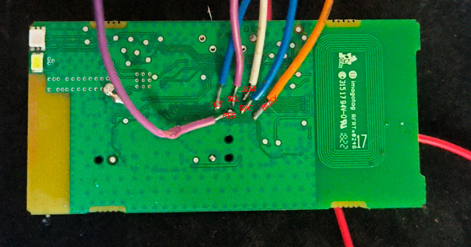

# VUSION 2.6" E-Paper ESL on ESP32-C3


A minimal, dependency-free driver for the e-paper panel inside a
**SES-imagotag VUSION 2.6" electronic shelf label**, running on an
**ESP32-C3 Super Mini**.

The label's original MCU is not used. The display flex is traced out and driven
directly over SPI, which turns a disposable shelf label into a reusable,
battery-friendly e-paper module that costs almost nothing.

<!-- Hero image: docs/images/hero.jpg -->
<!--  -->

## Project overview

Electronic shelf labels are single-purpose devices: the panel, the boost
converter and the charge-pump capacitors are already on the label PCB, and the
panel is glued in place. Throwing the label away means throwing away a perfectly
good 296×152 three-colour display.

This project documents how to:

1. Identify the panel and its controller without a datasheet.
2. Attach an ESP32-C3 to the panel's SPI signals and keep the label's power
   path intact.
3. Initialise and refresh the panel with a small, readable driver instead of a
   full vendor stack.

There is no vendor SDK, no Arduino library and no radio stack in the firmware.
The transport and panel driver together are about 250 lines of C++, split into a
transport layer, a panel driver and a drawing layer.

> **Controller note.** The panel in this label uses Pervasive Displays' **iTC**
> controller, not an IL0373, UC8151 or SSD16xx. The IL0373 / GDEW026Z39 pairing
> is common on 296×152 panels, but it does not apply here: command framing,
> BUSY polarity and framebuffer layout are all different. See
> [docs/controller-notes.md](docs/controller-notes.md) before reusing this code
> on another label.

## Hardware

| Item | Detail |
| --- | --- |
| Target label | SES-imagotag VUSION 2.6" (2.66" class, UU340 family) |
| Label MCU | EFR32FG22 Wireless Gecko (not used) |
| Panel | Pervasive Displays SE2266JS0C1 / E2266JS0C1 |
| Resolution | 296 × 152, 125 dpi |
| Colours | Black / white / red (Spectra film J) |
| Active area | 60.09 × 30.70 mm |
| Controller | Pervasive iTC, 4-wire SPI |
| Driving MCU | ESP32-C3 Super Mini (RISC-V, 4 MB flash) |
| Framework | Arduino / PlatformIO |
| Logic level | 3.3 V |

Silkscreen markings and test-point names vary between label revisions. Verify
the flex pinout on your own board before applying power.

## Pinout and wiring

The ESP32-C3 pins below avoid the strapping pins (GPIO 2/8/9), the USB pins
(GPIO 18/19) and UART0 (GPIO 20/21).

| ESP32-C3 | Panel signal | Direction | Notes |
| --- | --- | --- | --- |
| GPIO 4 | SCL / SCK | Out | SPI clock |
| GPIO 6 | SDA / MOSI | Out | Data to panel (bidirectional only for the OTP read) |
| GPIO 7 | CS | Out | Chip select, active low |
| GPIO 5 | D/C | Out | Low = command, high = data |
| GPIO 1 | RES | Out | Reset, active low |
| GPIO 0 | BUSY | In | Open-drain, **low = busy**; internal pull-up enabled |
| GPIO 3 | Panel VDD gate | Out | High-side P-MOSFET gate, low = panel on |
| 3V3 | VDD / VDDIO | Power | 100 nF + 10 µF at the connector |
| GND | GND | Power | Common ground |

Solder 30 AWG wire to the panel flex pads or to the vias on the corresponding
nets. Exact test-point labels and a per-board trace map are in
[docs/pinout.md](docs/pinout.md); a machine-readable version is in
[hardware/pinout.csv](hardware/pinout.csv).



*Panel-side wiring on the label PCB. The display flex connector is at the upper
left; the SPI and power wires are soldered to the corresponding vias.*

## Power and safety

- **3.3 V only.** The panel and its boost converter are not 5 V tolerant.
- **Use a high-side switch.** A P-channel MOSFET between 3V3 and panel VDD,
  with a 10 kΩ gate pull-up, keeps the panel unpowered while the ESP32 boots.
  GPIO 3 drives the gate low to power the panel. Set
  `EPD_PANEL_POWER_PIN` to `-1` in
  [firmware/include/epd_config.h](firmware/include/epd_config.h) if VDD is wired
  straight to 3V3.
- **The original prototype drove VDD directly from GPIO 3** (active high, no
  MOSFET). That works for bench bring-up and is available as the `direct`
  build environment, but a GPIO cannot supply the refresh current peaks. Use
  the MOSFET for anything permanent.
- **Keep the bulk capacitance.** Refresh current peaks in the tens of
  milliamps. Place 100 µF and 10 µF close to the flex connector and use a solid
  USB supply.
- **Keep the charge-pump capacitors.** The 1 µF boost capacitors are on the
  label PCB, not on the panel. Without them the DC/DC converter never starts
  and BUSY stays asserted.
- **Never connect or disconnect the flex while powered.**
- **Do not experiment with waveform/PSR values.** Wrong drive voltages degrade
  the panel permanently.
- **Refresh sparingly.** A full update takes 15–25 s and consumes panel cycles.
  Between updates the image is retained with the DC/DC off and the ESP32 can
  sleep.
- **ESD:** the panel driver is exposed on the flex. Ground yourself before
  handling it.

## Quick start

Requirements: [PlatformIO Core](https://platformio.org/install/cli) and a
USB-C data cable.

```bash
git clone https://github.com/<your-user>/imagotag-rfrtx024g.git
cd imagotag-rfrtx024g/firmware

pio run -t upload          # build and flash
pio device monitor         # 115200 baud
```

On boot the firmware initialises the panel, draws an identification card and
runs one refresh. The first refresh takes 15–25 s; that is expected.

Boards without a native USB-CDC bridge need `ARDUINO_USB_CDC_ON_BOOT=1`, which
is already set in `platformio.ini`.

### Serial console

| Key | Action |
| --- | --- |
| `w` | Fill white |
| `k` | Fill black |
| `r` | Fill red |
| `p` | Geometry / colour test pattern |
| `e` | Identification card |
| `i` | Re-initialise the panel |
| `s` | DC/DC off (image retained) |
| `t` | Trace BUSY for 15 s during booster start-up |
| `h` | Print help |

### Build variants

| Environment | Purpose |
| --- | --- |
| `release` | Identification card at boot (default) |
| `pattern` | Test pattern at boot |
| `slow` | 500 kHz bus, 30 µs CS setup time, for long or noisy wiring |
| `direct` | Panel VDD driven directly from GPIO 3, no MOSFET (bench prototype) |

```bash
pio run -e pattern -t upload
```

## Repository layout

```text
.
├── docs/
│   ├── assets.md            # photo / capture shot list and placement
│   ├── controller-notes.md  # iTC vs IL0373 / UC8151 / SSD16xx
│   ├── images/              # photos, diagrams, captures
│   ├── pinout.md            # detailed wiring and test points
│   └── protocol.md          # iTC command sequence and framebuffer format
├── firmware/
│   ├── include/
│   │   ├── epd_config.h     # pins, geometry, orientation, tunables
│   │   ├── epd_hal.h        # SPI / GPIO / BUSY transport
│   │   ├── epd_itc.h        # panel driver API
│   │   ├── font5x7.h        # 5×7 bitmap font
│   │   └── gfx.h            # drawing primitives
│   ├── src/
│   │   ├── epd_hal.cpp
│   │   ├── epd_itc.cpp
│   │   ├── gfx.cpp
│   │   └── main.cpp
│   └── platformio.ini
├── hardware/
│   ├── README.md            # BOM, power path, assembly notes
│   └── pinout.csv           # machine-readable wiring table
├── LICENSE
├── NOTICE
└── README.md
```

## How it works

The driver is split so each layer can be tested on its own:

- `epd_hal` owns the bus: GPIO setup, hardware SPI, reset timing and the BUSY
  handshake. It knows nothing about panel commands.
- `epd_itc` owns the protocol: the init sequence, the two 1 bpp planes and the
  refresh state machine. Drawing addresses a top-left origin with logical
  colours; panel quirks are applied inside this layer.
- `gfx` provides text and simple vector primitives on top of `epd::pixel`.

The full command sequence, framebuffer encoding and the iTC quirks that break
naive implementations are documented in [docs/protocol.md](docs/protocol.md).

## Troubleshooting

| Symptom | Likely cause |
| --- | --- |
| BUSY never releases | Booster capacitors missing, weak supply, or RES not connected |
| Init reports OK, nothing appears | Command and data split across two CS frames |
| Image rotated 90° or split into vertical bands | Row-major buffer sent to an iTC panel |
| Colours swapped | Black/red plane polarity (`EPD_INVERT`) |
| Faint or partial image | Temperature register, or a single refresh is not enough |
| Garbled glyphs | SPI clock too high for the wiring, or the wrong bit order |

## Credits

- [OpenEPaperLink](https://github.com/OpenEPaperLink) — open firmware and
  tooling for electronic shelf labels, and the reason these panels are worth
  rescuing.
- [BoardExplorer](https://github.com/brnomt/BoardExplorer) — used during the
  reverse-engineering of the label PCB and its display connector.
- **BeatSkip — ShelfKit** — reference work on driving SES-imagotag labels.
- **Pervasive Displays** — `PDLS_Basic` and `PDLS_EXT3_Basic_Global`, used as
  the reference for the iTC sequences and buffer format.
- **Adafruit GFX** — the 5×7 glyph table in `font5x7.h` (BSD licence).

## License

Code and documentation are released under the [MIT License](LICENSE). The
bitmap font is derived from Adafruit GFX; see [NOTICE](NOTICE).

Hardware documentation is provided as-is, without warranty. Reusing a
decommissioned label is your own responsibility; respect local e-waste and
product ownership rules.

## Contributing

Corrections, board revisions and additional pinouts are welcome. If you have a
different VUSION revision, open an issue with the silkscreen markings and a
photo of the flex connector.
