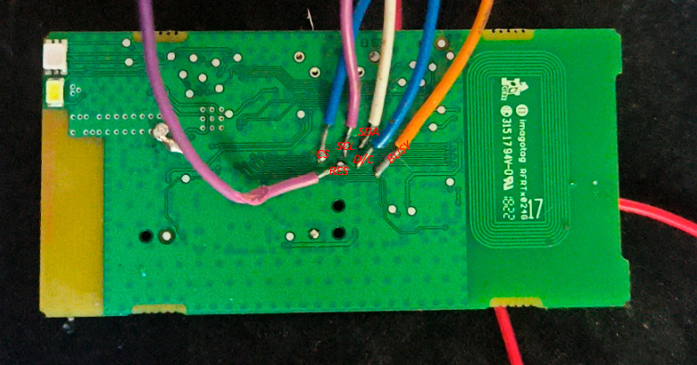

# Pinout and wiring

This page is the electrical reference for the ESP32-C3 Super Mini harness. The
signal side is verified on the unit documented here; the per-board attachment
table is a template to complete for each label revision.

## 1. Signal map

| Panel signal | Direction | ESP32-C3 GPIO | Notes |
| --- | --- | --- | --- |
| SCL | Panel input | 4 | SPI clock, up to a few MHz |
| SDA | Panel input | 6 | Data; also the bidirectional OTP line on 3-wire parts |
| CS | Panel input | 7 | Active low, must idle high |
| D/C | Panel input | 5 | Low = command, high = data |
| RES | Panel input | 1 | Active low; 10 ms pulse |
| BUSY | Panel output | 0 | Open-drain, low = busy; needs a pull-up |
| VDD / VDDIO | Power | 3V3 (switched) | 100 nF + 10 µF at the connector |
| GND | Power | GND | Keep the ground return short |
| VPP, C1–C4 | Power | — | Boost converter; stays on the label PCB |

### Why these GPIOs

- GPIO 2, 8 and 9 are ESP32-C3 strapping pins and change boot behaviour.
- GPIO 18/19 are USB D-/D+ and are used by the native USB-CDC console.
- GPIO 20/21 are UART0.
- GPIO 10 is used as a dummy MISO so that `SPI.begin()` is always called with
  explicit pins. The ESP32-C3 default SPI2 mapping (CLK 6 / MOSI 7) does not
  match this harness, and an argument-less `SPI.begin()` silently uses it.

## 2. Board attachment points

The ESP32-C3 is wired to the panel side of the label. On the label PCB these
nets run from the display flex to the original MCU. Two practical attachment
options exist:

1. **FPC pads** — solder 30 AWG wire directly to the flex tail pads. Most
   reliable, but the flex is fragile and must be strain-relieved.
2. **Test pads / vias** — solder to the labelled test points or vias on the same
   nets. Easier, but the net names differ between board revisions.

Record the exact points for your board here. Do not guess: a wrong net can put
3.3 V on a boost node.

| Panel signal | Label PCB pad / test point | Board revision | Verified |
| --- | --- | --- | --- |
| SCL | TBC | TBC | ☐ |
| SDA | TBC | TBC | ☐ |
| CS | TBC | TBC | ☐ |
| D/C | TBC | TBC | ☐ |
| RES | TBC | TBC | ☐ |
| BUSY | TBC | TBC | ☐ |
| VDD | TBC | TBC | ☐ |
| GND | TBC | TBC | ☐ |

A printable/machine-readable copy lives in
[../hardware/pinout.csv](../hardware/pinout.csv).

## 3. Power path

```text
USB-C 5 V ──► ESP32-C3 Super Mini ──► 3V3 rail
                                          │
                                    P-MOSFET (high-side switch)
                                          │
                              ┌───────────┴───────────┐
                              │                       │
                         100 nF + 10 µF           Panel VDD / VDDIO
                              │                       │
                             GND                     GND
```

- Source: 3V3. Drain: panel VDD/VDDIO. Gate: GPIO 3 with a 10 kΩ pull-up to
  3V3.
- The gate is pulled high at reset, so the panel stays unpowered while the
  ESP32 boots. Firmware drives it low to power the panel.
- If no MOSFET is fitted, connect VDD/VDDIO directly to 3V3 and set
  `EPD_PANEL_POWER_PIN = -1` in `epd_config.h`.
- The prototype for this project drove VDD/VDDIO directly from GPIO 3, active
  high, with no MOSFET (`env:direct`). This is only acceptable for bench
  bring-up: a GPIO cannot supply the refresh current peaks.

## 4. Flex notes

The display flex carries more than the SPI signals: it also distributes VDD,
VDDIO, ground and the boost converter nodes. The 1 µF charge-pump capacitors
sit on the label PCB next to the connector, not on the panel. If the label is
cut down or the flex is extended without those capacitors, the converter will
not start even though the SPI traffic looks correct.

- Do not fold or crease the flex.
- Never mate or unmate the connector with power applied.
- Strain-relieve the wires so the flex pads do not take the load.
- Keep the SPI wires under ~15 cm for reliable operation above 1 MHz.

## 5. Continuity check

Before applying power:

1. With the panel disconnected, verify 3V3 and GND are not shorted.
2. Check each ESP32-C3 pin against its panel pad: SCL, SDA, CS, D/C, RES,
   BUSY, VDD, GND.
3. Confirm BUSY idles high through its pull-up. A permanently low BUSY means
   the line is shorted or the panel is unpowered.
4. Power the board with the panel connected and confirm 3.3 V at the panel
   connector before sending any command.

## 6. Photos



*Panel-side wiring on the label PCB. The display flex connector is at the upper
left; the SPI and power wires are soldered to the corresponding vias.*

Still needed for this page:

- `images/pcb-test-points.jpg` — macro of the labelled test pads
- `images/fpc-connector.jpg` — flex mated in the connector
- `images/solder-joints.jpg` — the eight wires on the panel side
- `images/wiring-overview.jpg` — ESP32-C3 to label, full harness

See [assets.md](assets.md) for capture requirements.
